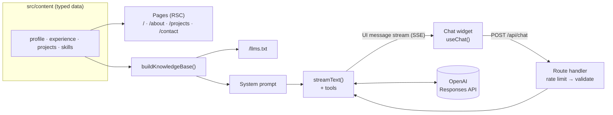

# Luis Miguel García Marín — AI Portfolio

Personal portfolio of **Luis Miguel García Marín**, Software Engineer specialized in AI and full-stack development, with an **AI assistant that answers questions about my career in my own voice** — in any language.

**Live:** [luismigarcia.com](https://www.luismigarcia.com) · **Machine-readable profile:** [/llms.txt](https://www.luismigarcia.com/llms.txt)

## Highlights

- **Grounded AI assistant** — answers from a single, typed source of truth; no hallucinated jobs or dates (checked by an eval suite with an LLM judge).
- **Long-context instead of RAG** — the whole knowledge base (~4k tokens) is sent with each request, with **prompt caching** to keep it cheap and fast. See [ADR-0001](docs/adr/0001-long-context-instead-of-rag.md).
- **Tool calling + generative UI** — the model can call typed tools that render project and contact cards as React components inside the chat, while the answer streams.
- **Production guardrails** — input validation, sliding history window, per-IP and global rate limits, output caps, sanitized logs, hardened system prompt, no conversation storage at the provider.
- **Modern stack** — Next.js 16 (App Router, React Server Components, Server Actions, React Compiler), React 19, Tailwind CSS 4, Vercel AI SDK 7, OpenAI Responses API.
- **Self-documenting repo** — a docs guard (Claude Code hook + git hook + CI) blocks code changes that don't update their documentation.

## Architecture at a glance



More in [docs/ARCHITECTURE.md](docs/ARCHITECTURE.md) and [docs/CHATBOT.md](docs/CHATBOT.md).

## Tech stack

| Area      | Technology                                                                                    |
| --------- | --------------------------------------------------------------------------------------------- |
| Framework | Next.js 16 (App Router, Turbopack, React Compiler), React 19, TypeScript 5.9                  |
| UI        | Tailwind CSS 4, `next-themes` (light/dark), Lucide & React Icons, `react-markdown`            |
| AI        | Vercel AI SDK 7 (`ai`, `@ai-sdk/react`, `@ai-sdk/openai`), OpenAI `gpt-6-luna` (configurable) |
| Safety    | Zod 4 validation, Upstash Ratelimit (optional; in-memory fallback)                            |
| Contact   | Server Action → Formspree                                                                     |
| Quality   | ESLint 9 (flat config), Prettier, Vitest, LLM eval suite, GitHub Actions                      |
| Hosting   | Vercel (Preview on `develop`, Production on `main`), Vercel Analytics & Speed Insights        |

## Getting started

Requirements: **Node.js ≥ 22** (see `.nvmrc`).

```bash
npm install                 # also enables the git hooks in .githooks/
cp .env.example .env.local  # then fill in OPENAI_API_KEY (and FORMSPREE_ENDPOINT for the contact form)
npm run dev                 # http://localhost:3000
```

The site works without any env vars; only the chat (`OPENAI_API_KEY`) and the contact form (`FORMSPREE_ENDPOINT`) need them. All variables are documented in [`.env.example`](.env.example) and [docs/DEPLOYMENT.md](docs/DEPLOYMENT.md).

## Scripts

| Command                           | What it does                                                              |
| --------------------------------- | ------------------------------------------------------------------------- |
| `npm run dev`                     | Dev server with Turbopack                                                 |
| `npm run build` / `start`         | Production build / serve it                                               |
| `npm run check`                   | Lint + typecheck + unit tests (what CI runs, minus the build)             |
| `npm run lint` · `lint:fix`       | ESLint                                                                    |
| `npm run format` · `format:check` | Prettier (with Tailwind class sorting)                                    |
| `npm run typecheck`               | Generates Next.js route types, then `tsc --noEmit`                        |
| `npm test` · `test:watch`         | Vitest unit tests                                                         |
| `npm run eval`                    | Chatbot eval suite against the real model (`-- --judge` for LLM-as-judge) |
| `npm run docs:check`              | Docs guard: which docs must change given your code changes                |

## Project structure

```
src/
  app/                 Routes (App Router): pages, /api/chat, /llms.txt, sitemap, robots, OG image
  components/          UI: layout, chat widget, home, about, projects, ui primitives
  content/             ★ Single source of truth: profile, experience, projects, skills, site
  lib/ai/              Assistant: config, knowledge base, prompt, tools, request policy, errors
  lib/                 Rate limiting, dates, utils
evals/                 Chatbot eval cases
scripts/               eval runner, docs guard
docs/                  Architecture, chatbot, deployment, content, development, ADRs, AI study guide
.claude/               Claude Code: hooks, skills, subagents
.githooks/             Git hooks (pre-commit)
.github/               CI, evals workflow, Dependabot, PR template
```

## Documentation

| Doc                                        | For                                                                 |
| ------------------------------------------ | ------------------------------------------------------------------- |
| [Architecture](docs/ARCHITECTURE.md)       | How the app is put together, rendering, data flow                   |
| [Chatbot](docs/CHATBOT.md)                 | The assistant in depth: prompt, tools, guardrails, cost, evals      |
| [Deployment](docs/DEPLOYMENT.md)           | Vercel environments, env vars, OpenAI key, Upstash, troubleshooting |
| [Content](docs/CONTENT.md)                 | How to update profile, jobs and projects                            |
| [Development](docs/DEVELOPMENT.md)         | Workflow, conventions, git hooks, CI, Claude Code automation        |
| [ADRs](docs/adr/README.md)                 | Architecture Decision Records                                       |
| [AI concepts (ES)](docs/AI-CONCEPTS.es.md) | Study guide of the AI/LLM concepts used here (in Spanish)           |
| [Changelog](CHANGELOG.md)                  | Release history                                                     |

## License

The source code is available for reference and learning. The personal content (texts, photos and project images) belongs to Luis Miguel García Marín — please don't reuse it as your own.
