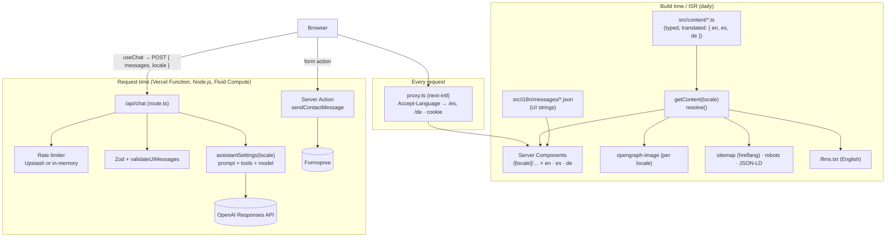

# Architecture

## Overview

A Next.js 16 App Router application deployed on Vercel, available in **English, Spanish and German**. It has two halves that share one data source:

1. **The website** — static pages rendered with React Server Components (RSC) from typed, translated content, with a playful interactive layer on top.
2. **The AI assistant** — a streaming chat endpoint that grounds an OpenAI model on that same content.



## Internationalization (i18n)

Built with [next-intl](https://next-intl.dev). Decision record: [ADR-0005](adr/0005-i18n-next-intl-typed-content.md).

| Piece                               | What it does                                                                                                                                        |
| ----------------------------------- | --------------------------------------------------------------------------------------------------------------------------------------------------- |
| `src/i18n/routing.ts`               | Locales (`en`, `es`, `de`), default `en`, `localePrefix: "as-needed"`                                                                               |
| `src/proxy.ts`                      | Next.js 16 proxy (formerly middleware): on a first visit picks the language from `Accept-Language`, then remembers the visitor's choice in a cookie |
| `src/app/[locale]/…`                | Every page lives under the locale segment; `generateStaticParams` pre-renders all three                                                             |
| `src/i18n/request.ts`               | Loads the message catalogue for the request (via `next/root-params`)                                                                                |
| `src/i18n/navigation.ts`            | Locale-aware `Link`, `useRouter`, `usePathname`, `getPathname` — always use these, not `next/link`                                                  |
| `src/i18n/messages/{en,es,de}.json` | UI strings. `en.json` is the reference; its type is enforced through `src/global.d.ts`                                                              |
| `src/i18n/server.ts`                | `localeFromParams()` (validates the param, 404 otherwise) and `localizedMetadata()` (canonical + `hreflang`)                                        |

URLs: `/about` (English), `/es/about`, `/de/about`. Unknown paths inside a locale hit `[...rest]` → localized 404.

**Content vs UI strings.** Facts (jobs, projects…) live in `src/content` with inline translations; interface copy (buttons, headings, errors) lives in the JSON catalogues. See [CONTENT.md](CONTENT.md).

**The assistant and languages.** The knowledge base is always built in English (one canonical, cacheable prompt). The page language is sent with each chat request and placed at the _end_ of the system prompt; the model answers in the language the visitor writes in, falling back to the page language. Tool outputs (project/contact cards) and API errors are returned in the page language. Details in [CHATBOT.md](CHATBOT.md#languages).

## Rendering strategy

| Route                                        | Type                                 | Notes                                                                      |
| -------------------------------------------- | ------------------------------------ | -------------------------------------------------------------------------- |
| `/[locale]`, `/[locale]/about`               | SSG × 3 + ISR (`revalidate = 86400`) | Re-rendered daily so computed durations/years stay current                 |
| `/[locale]/projects`, `/contact`, `/privacy` | SSG × 3                              | Pure content                                                               |
| `/[locale]/opengraph-image`                  | SSG × 3                              | Social preview image per language via `next/og`                            |
| `/llms.txt`                                  | Static + ISR (daily)                 | Markdown knowledge base for AI agents ([llmstxt.org](https://llmstxt.org)) |
| `/sitemap.xml`, `/robots.txt`                | Static                               | Sitemap entries carry `hreflang` alternates                                |
| `/api/chat`                                  | Dynamic (Function)                   | Streaming; `maxDuration = 60` s; Fluid Compute (`vercel.json`)             |
| `proxy.ts`                                   | Every page request                   | Locale detection/redirects only                                            |

Client Components are kept at the leaves (header, chat, background, hero toys, carousels, form). Everything else is a Server Component. The **React Compiler** (`reactCompiler: true`) memoizes automatically.

## Content model

`src/content/` holds typed data (see `types.ts`). Text fields are either a plain `string` (same in every language) or an `L = { en, es, de }` object — TypeScript requires all three. `getContent(locale)` deep-resolves everything to plain strings (cached per locale), so components receive simple data. Projects are sorted newest-first by `sortProjects` (ongoing → end year → start year). Dates are `YYYY-MM`; durations and "years of experience" are computed in `src/lib/dates.ts` with `Intl.DateTimeFormat` / `Intl.DurationFormat` in the visitor's language.

## Interactive layer

All motion uses [Motion](https://motion.dev) (`motion/react`) or CSS, and **respects `prefers-reduced-motion`** (`MotionProvider` sets `reducedMotion="user"`; CSS has a global reduced-motion rule). Hover-only effects are gated with the `pointer-fine:` variant so touch devices aren't affected.

| Component                                     | Behavior                                                                                                                                                                                                                                |
| --------------------------------------------- | --------------------------------------------------------------------------------------------------------------------------------------------------------------------------------------------------------------------------------------- |
| `background/living-background.tsx`            | Dotted canvas + three morphing gradient blobs (the 2024 background, alive). Blobs rearrange per page, drift with cursor and scroll (parallax); dots light up around the cursor; clicking empty space sends a ripple; film grain overlay |
| `layout/site-header.tsx`                      | Floating pill with the 2024 gradient as an animated conic border, sliding active pill (`layoutId`), hover underline, compacts on scroll, hides on scroll-down, scroll-progress line, mobile sheet menu                                  |
| `layout/theme.tsx`                            | Theme toggle with a circular reveal (View Transitions API)                                                                                                                                                                              |
| `layout/language-switcher.tsx`                | Dropdown (desktop) and segmented control (mobile)                                                                                                                                                                                       |
| `home/interactive-portrait.tsx`               | 3D tilt towards the cursor, glow on hover, squash-and-stretch bounce + emoji burst + fun-fact bubble on click, easter egg after 5 clicks                                                                                                |
| `home/rotating-roles.tsx`, `home/ask-box.tsx` | Rotating role titles; typewriter placeholder cycling example questions                                                                                                                                                                  |
| `motion/*`                                    | `Reveal` (fade-up on scroll), `Magnetic` (buttons pulled by the cursor), `SpotlightCard` (light following the cursor), `CountUp`                                                                                                        |
| `about/timeline-progress.tsx`                 | Timeline line that fills as you scroll                                                                                                                                                                                                  |
| `projects/project-card.tsx`                   | Carousel with swipe, arrow keys and uncropped images over a blurred fill                                                                                                                                                                |
| `chat/chat-widget.tsx`                        | Launcher with Luis's avatar, one-time nudge bubble, spring-animated panel                                                                                                                                                               |

## Directory layout

```
src/app/
  [locale]/               localized pages, layout (html lang), not-found, OG image, contact action
  api/chat/route.ts       chat endpoint
  llms.txt/ sitemap.ts robots.ts favicon.ico globals.css (design tokens)
src/proxy.ts              locale detection (next-intl)
src/i18n/                 routing, navigation, request config, server helpers, messages/{en,es,de}.json
src/components/
  background/ layout/ motion/ chat/ home/ about/ projects/ ui/
src/content/              typed, translated content + resolve()/getContent()
src/lib/ai/               assistant (settings), config, knowledge, prompt, tools, request policy, errors, API messages
src/lib/                  rate-limit, dates, utils (cn)
```

## Chat data flow

1. `ChatProvider` (in the locale layout) owns one `useChat<ChatUIMessage>()` session, mirrored to `sessionStorage`.
2. `sendMessage(…, { body: { locale } })` POSTs `{ id, messages, locale }` to `/api/chat`.
3. The route rate-limits, validates, trims history, and calls `streamText({...assistantSettings({ locale }), messages})`.
4. The response is a **UI message stream** (SSE) of typed chunks: text deltas, tool inputs/outputs, steps, errors.
5. The widget renders `message.parts`: Markdown (internal links go through the locale-aware `Link`) and React cards for tool parts.

Details, guardrails and costs: [CHATBOT.md](CHATBOT.md).

## Design system

Tokens live in `src/app/globals.css` as OKLCH CSS variables exposed to Tailwind 4 via `@theme inline`. Besides the core palette there are the **legacy** tokens (`--legacy-1..3`, the 2024 navbar's purple → indigo → blue) and **blob** tokens (the 2024 background's pink → lavender → periwinkle), each with light and dark values. Custom utilities: `text-gradient`, `bg-brand-gradient`, `bg-legacy-gradient`, `gradient-border` (animated conic border via `@property`), `blob` (morphing shape), `bg-dots`, `bg-grain`, `spotlight`, `underline-grow`, `bg-cover-pattern`, `mask-fade-x`.

## Security

- Security headers in `next.config.ts` (`X-Frame-Options`, `nosniff`, `Referrer-Policy`, `Permissions-Policy`).
- Model output is rendered with `react-markdown` (no raw HTML); unknown link protocols are dropped.
- Secrets are server-only env vars. Chat logs contain token counts, never message content.
- Chat guardrails: see [CHATBOT.md → Guardrails](CHATBOT.md#guardrails).

## Key dependencies

`next` 16 · `react` 19 · `next-intl` 4 · `motion` 14 · `ai` 7 / `@ai-sdk/react` 4 / `@ai-sdk/openai` 4 · `zod` 4 · `tailwindcss` 4 · `@upstash/ratelimit` 2 · `react-markdown` 10 · `next-themes`. Dev: `eslint` 9 + `eslint-config-next`, `prettier` + Tailwind plugin, `vitest`, `tsx`.

Decisions behind these choices are recorded in [adr/](adr/README.md).
