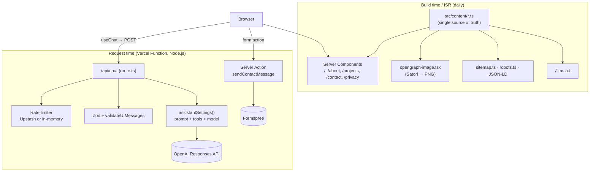

# Architecture

## Overview

A Next.js 16 App Router application deployed on Vercel. It has two halves that share one data source:

1. **The website** — mostly static pages rendered with React Server Components (RSC) from typed content.
2. **The AI assistant** — a streaming chat endpoint that grounds an OpenAI model on that same content.



## Rendering strategy

| Route                               | Type                                | Notes                                                                      |
| ----------------------------------- | ----------------------------------- | -------------------------------------------------------------------------- |
| `/`, `/about`                       | Static + ISR (`revalidate = 86400`) | Re-rendered daily so computed durations/years stay current                 |
| `/projects`, `/contact`, `/privacy` | Static                              | Pure content                                                               |
| `/llms.txt`                         | Static + ISR (daily)                | Markdown knowledge base for AI agents ([llmstxt.org](https://llmstxt.org)) |
| `/opengraph-image`                  | Static (generated at build)         | Social preview image via `next/og`                                         |
| `/sitemap.xml`, `/robots.txt`       | Static                              | Generated from `navigation`                                                |
| `/api/chat`                         | Dynamic (Function)                  | Streaming; `maxDuration = 30` s                                            |

Client Components are kept at the leaves: the chat widget/provider, header (active link, mobile menu), theme toggle, project carousel, home ask box and contact form. Everything else is a Server Component and ships no JS.

The **React Compiler** (`reactCompiler: true` in `next.config.ts`) memoizes components automatically, so the code has no manual `useMemo`/`useCallback`.

## Content model

`src/content/` holds plain typed data (see `types.ts`): `profile`, `experience` (+ `education`, `certifications`, `awards`), `projects`, `skills`, `site` (navigation, chat suggestions). Consumers:

- Pages and components import it directly.
- `src/lib/ai/knowledge.ts` serializes it to Markdown for the assistant and `/llms.txt`.
- `layout.tsx` builds JSON-LD (`schema.org/Person`) and metadata from it.

Dates are `YYYY-MM` strings; durations and "years of experience" are computed in `src/lib/dates.ts`. See [CONTENT.md](CONTENT.md) for how to edit.

## Directory layout

```
src/app/                  routes, layout, globals.css (design tokens), SEO files
  api/chat/route.ts       chat endpoint
  contact/actions.ts      contact Server Action
src/components/
  chat/                   ChatProvider (useChat + persistence), ChatWidget, tool cards, markdown
  layout/                 header, footer, theme, social links
  about/ home/ projects/  page sections
  ui/                     Button, Card, Badge, SectionHeading… (design-system primitives)
src/lib/ai/               assistant (settings), config, knowledge, prompt, tools, request policy, errors
src/lib/                  rate-limit, dates, utils (cn)
```

## Chat data flow

1. `ChatProvider` (in the root layout) owns one `useChat<ChatUIMessage>()` session, so the conversation survives navigation; it mirrors messages to `sessionStorage`.
2. On send, the AI SDK's default transport POSTs `{ id, messages }` to `/api/chat`.
3. The route rate-limits, validates, trims history, and calls `streamText({...assistantSettings(), messages})`.
4. The response is a **UI message stream** (Server-Sent Events) of typed chunks: text deltas, tool inputs/outputs, step boundaries, errors.
5. The widget renders `message.parts`: Markdown for `text`, React cards for `tool-showProjects` / `tool-showContactCard`.

Details, guardrails and costs: [CHATBOT.md](CHATBOT.md).

## Design system

Tokens live in `src/app/globals.css` as CSS variables in OKLCH, exposed to Tailwind 4 via `@theme inline` (`bg-background`, `text-muted-foreground`, `bg-brand-gradient`, `text-gradient`…). Dark mode is class-based (`next-themes` adds `.dark` on `<html>`; `@custom-variant dark`). Gradient backgrounds and gradient text use separate tokens so both keep enough contrast in each theme. `prefers-reduced-motion` disables animations.

## Security

- Security headers in `next.config.ts` (`X-Frame-Options`, `nosniff`, `Referrer-Policy`, `Permissions-Policy`).
- Model output is rendered with `react-markdown` (no raw HTML); external links get `rel="noopener noreferrer"`, unknown protocols are dropped.
- Secrets are server-only env vars (no `NEXT_PUBLIC_` prefix). Chat logs contain token counts, never message content.
- Chat-specific guardrails: see [CHATBOT.md → Guardrails](CHATBOT.md#guardrails).

## Key dependencies

`next` 16 · `react` 19 · `ai` 7 / `@ai-sdk/react` 4 / `@ai-sdk/openai` 4 · `zod` 4 · `tailwindcss` 4 · `@upstash/ratelimit` 2 · `react-markdown` 10 · `next-themes` · `@vercel/analytics` / `speed-insights`. Dev: `eslint` 9 + `eslint-config-next`, `prettier` + Tailwind plugin, `vitest`, `tsx`.

Decisions behind these choices are recorded in [adr/](adr/README.md).
